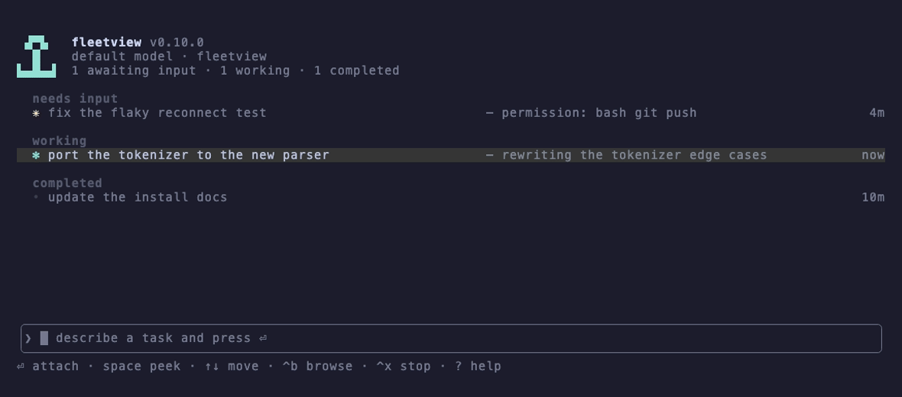
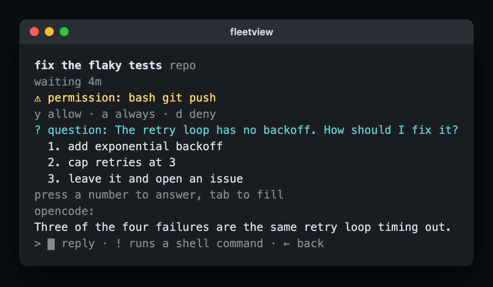

# fleetview

One screen for all your background coding agents. Dispatch tasks to
[opencode](https://opencode.ai), Claude Code, or GitHub Copilot CLI; watch every session's
status live; answer their questions with a single keypress; attach to any of them. Close
fleetview and the sessions keep running — reopen and pick up where you left off.

## 30 seconds to your first session

    npm i -g fleetview
    fleetview

Or try it without installing: `npx fleetview`. Nothing is installed globally, but the opencode
server it starts keeps running after you quit; `fleetview server stop` stops it.

npm 11 warns about the install scripts of `fleetview` and `node-pty` (the terminal attach
helper). To approve just those two, install with `npm i -g fleetview --allow-scripts=node-pty,fleetview`.

Type a task and press ⏎: a session starts on it. With the input empty, ⏎ on a row attaches to
that session, and `^z` detaches and leaves it running in the background.

Requirements: Node 24 or newer, macOS or Linux, and at least one of the `opencode`, `claude` or
`copilot` CLIs on `PATH`. opencode is optional but is the full experience: it is the default
backend, and answering questions from the roster, `!` shell jobs, `/fork`, `/model` and worktree
isolation all need it. No registration: on first run fleetview spawns one detached
`opencode serve`, and browse (`^b`) lists every directory you have ever run opencode in, grouped
by project with live status. Without opencode the roster opens on claude and copilot alone,
watching the directory you launched it in plus any directory already on the roster.

## What you get

**A live roster.** Sessions grouped by state — `needs input` on top, then `working`, then
`completed` — with each row showing what the session is doing right now, streamed as it happens
and never costing a model call. Open pull requests ride along as `#1234` labels, coloured by
what needs attention.

**Answer without attaching.** `space` peeks at a session: its recent output, whatever it's
blocked on, and a reply input. A permission is `y`/`a`/`d`; a question is a numbered list you
answer by pressing the number.

**One input for everything.** Type a task to dispatch it. `@repo` targets a repository, `@agent`
a subagent, `@claude`/`@copilot` another backend, `! cmd` runs a shell job, `s:blocked` filters.

**opencode dispatches are isolated.** An opencode session dispatched into a git repository runs
in its own git worktree on an ordinary branch, created before the session exists, so three agents
in one repository never fight over one working copy. Merge back with `git merge` or a pull
request. Claude Code and Copilot dispatches run in the checkout itself.
([details](docs/guide.md#opencode-sessions-get-their-own-worktree))

**Three backends, honestly compared.** opencode is the default and the most capable — it has a
server behind it. Claude Code and Copilot sessions are detached headless runs fleetview reads;
what they can't do, the roster says so instead of pretending. ([full table](docs/guide.md#backends))

**Scriptable.** `fleetview bg "<prompt>"` dispatches from any terminal, `fleetview --json`
reports states in the same words as `claude agents --json`, so scripts written against agent
view read fleetview too. `ls`, `--json`, `status`, `attach`, `logs`, `stop` and `rm` cover every
backend, and keep working for Claude Code and Copilot sessions when opencode is missing; the rest of
the shell commands (`fleetview --help` lists them all) act on opencode sessions only.
([CLI reference](docs/reference.md#from-the-shell))

**Locked down by default.** The opencode server fleetview spawns exposes shell execution, so
fleetview password-protects it with HTTP basic auth automatically. ([how](docs/reference.md#the-server-fleetview-spawns-is-password-protected))

## Where it comes from

fleetview is a deliberate port of Claude Code's agent view — the groups, the keys, the two-press
`^x`, the overloaded input, the worktree isolation and the `--json` state words are all agent
view's behaviour reproduced against opencode's server. Agent view is the specification; where
fleetview can't match it, or chooses not to, [the docs say so](docs/guide.md). Older audits,
plans and design notes are kept in [`docs/archive/`](docs/archive/).

## Keys

↑↓ move · ⏎ attach, or dispatch if there's text · space peek · ^z detach · ^s regroup ·
^t pin · ^r rename · ^x stop (again: delete) · ^b browse all sessions · ? everything else

`?` shows the full list, generated from the same table the keys are bound from.

## Learn more

- **[Guide](docs/guide.md)** — the screen, dispatching, peek, attaching, backends, worktrees, mouse
- **[Reference](docs/reference.md)** — CLI, environment variables, the spawned server, how it works
- **[CONTRIBUTING.md](CONTRIBUTING.md)** — from-source install and the development workflow
- **[SECURITY.md](SECURITY.md)** — threat model and how to report a vulnerability

Two things to know on an unfamiliar machine: `alt+1..9` can misfire over SSH, so set
`FLEETVIEW_NO_ALT_SWITCH=1` if you work remotely, and attaching needs `node-pty` (prebuilt on
macOS; Linux compiles it and needs `python3`, `make` and a C++ compiler).
